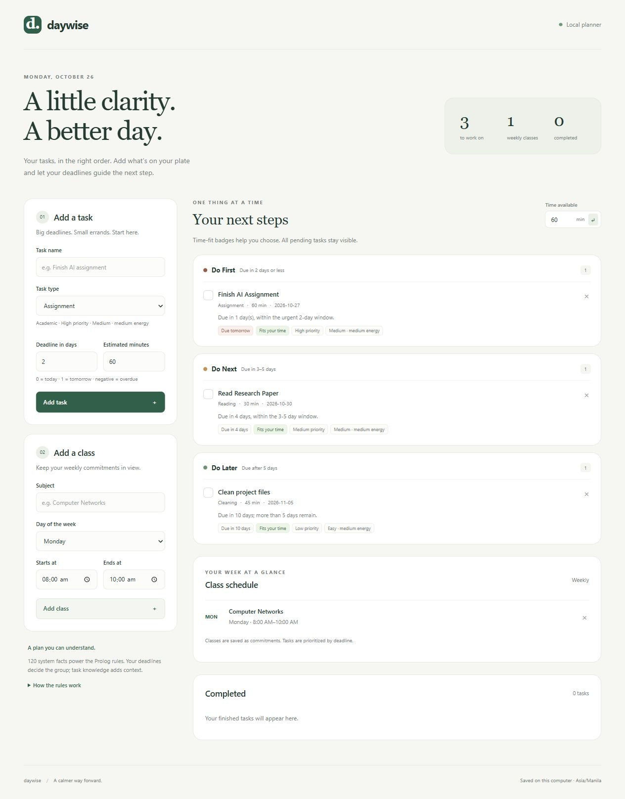

# AI-Based Adaptive Goal Planning and Task Recommendation System

A local task planner with an HTML interface and a SWI-Prolog backend. Users enter their tasks and weekly classes; Prolog applies deadline rules and task-type knowledge to recommend what to prioritize.

## Start the web app

Install [SWI-Prolog](https://www.swi-prolog.org/download/stable) and make `swipl` available on PATH. In PowerShell, run:

```powershell
.\web\run.ps1
```

Open [localhost:8080](http://localhost:8080). Use `-Port 8081` for another port. The launcher also recognizes an existing local runtime under `task_planner/.tools/swipl/`; runtime binaries are excluded from this repository.

On other platforms, with SWI-Prolog installed:

```sh
swipl -q -s web/server.pl -- 8080
```

## Features

- User-entered tasks, estimates, deadlines, and weekly classes.
- **Do First:** pending tasks due in 2 days or less, including overdue tasks.
- **Do Next:** pending tasks due in 3–5 days.
- **Do Later:** pending tasks due after 5 days.
- 120 meaningful system facts across 20 task types, separate from dynamic user facts.
- Type-based estimates and explanations, available-time badges, task completion and reopening.
- Clickable monthly calendar with a daily sequence of classes, suggested work, and free periods. Prolog splits allotted work time across vacant periods before deadlines; planning hours are editable (default 8 AM–10 PM).
- Local JSON persistence, input validation, and responsive desktop/mobile layouts.

The timetable uses recurring classes and user-entered task durations/deadlines. Suggestions cover the next 90 days, avoid class/task collisions, and report work that cannot fit. They are recalculated suggestions rather than confirmed reservations or automatic completion records. It is a single local planner, without accounts or cloud synchronization. Saved user data is excluded from Git.

## Project contents

- [`web/`](web/README.md): implemented web app, Prolog rules, tests, launchers, and verification previews.
- [`task_planner/`](task_planner/README.md): earlier standalone command-line planner, retained separately.
- `proj.pl` and `proj2.pl`: original Prolog prototypes.
- `Goal_and_Task_Recommendation_System_Writeup.docx` and its updated version: project write-ups.

## Tests

```powershell
.\web\run.ps1 -Mode test
.\web\smoke.ps1
```

The web implementation passed 51 PlUnit tests and 47 isolated HTTP integration checks, including class/task sequencing, splitting three hours around classes, shortage reporting, and persistence. Six optional calendar date tests run with `node --test web/calendar.test.cjs`. The HTTP script requires PowerShell 7+. See [`web/verification/README.md`](web/verification/README.md) for the checked workflows.

## Preview

The preview uses the specification's example tasks. They are not seeded into the application.


